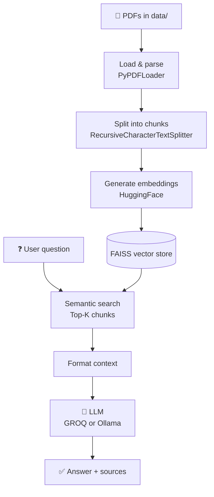

<div align="center">

# 📚 Mini RAG with GROQ & Ollama

**Ask questions about your PDF documents, powered by GROQ or a local Ollama model.**


[Features](#-features) · [Quick Start](#-quick-start) · [Configuration](#-configuration) · [How It Works](#-how-it-works) · [Troubleshooting](#-troubleshooting)

</div>

---

## 📋 Overview

A lightweight Retrieval-Augmented Generation (RAG) pipeline that turns a folder of PDFs into an interactive question-answering assistant.

| Step | What happens |
|------|--------------|
| 📥 **Load** | Reads every PDF from the local `data/` directory |
| ✂️ **Chunk** | Splits documents with recursive text splitting |
| 🧮 **Embed** | Creates vectors with HuggingFace sentence transformers |
| 🔎 **Retrieve** | Finds the most relevant chunks via FAISS similarity search |
| 💬 **Generate** | Answers using GROQ or Ollama |
| 📌 **Cite** | Returns sources with accurate page references |

## ✨ Features

- **Two interchangeable LLM backends**

  | Script | Backend | Best for |
  |--------|---------|----------|
  | `rag_pdf_groq.py` | ☁️ GROQ API | Speed and large models |
  | `rag_pdf_ollama.py` | 💻 Local Ollama | Privacy and offline use |

- **Semantic search** across multiple PDFs
- **Context-aware answers** with source citations
- **French prompts and responses** out of the box
- **Interactive CLI** for asking questions

## 🚀 Quick Start

### 1. Clone the repository

```bash
git clone https://github.com/Zahrat-ElOula/mini-RAG-with-GROQ-and-ollama.git
cd mini-RAG-with-GROQ-and-ollama
```

### 2. Create a virtual environment *(recommended)*

```bash
python -m venv venv
source venv/bin/activate      # Windows: venv\Scripts\activate
```

### 3. Install dependencies

```bash
pip install -r requirements.txt
```

<details>
<summary><b>📦 Packages installed</b></summary>

| Package | Purpose |
|---------|---------|
| `langchain`, `langchain-community` | Pipeline orchestration |
| `langchain-groq` | GROQ integration |
| `langchain-ollama` | Ollama integration |
| `langchain-huggingface` | Embeddings integration |
| `sentence-transformers` | Embedding models |
| `faiss-cpu` *(or `faiss-gpu`)* | Vector search |
| `PyPDF2` | PDF parsing |
| `python-dotenv` | `.env` loading |

</details>

### 4. Add your PDFs

```bash
mkdir data
cp your_document.pdf another_document.pdf data/
```

> 💡 Multiple PDFs are supported — they are all processed automatically.

### 5. Choose your backend

<table>
<tr>
<td width="50%" valign="top">

#### ☁️ GROQ

1. Get an API key at [console.groq.com](https://console.groq.com)
2. Create a `.env` file in the project root:

```env
GROQ_API_KEY=your_api_key_here
```

3. *(Optional)* Check the model in `rag_pdf_groq.py` — default: `llama-3.3-70b-versatile`

</td>
<td width="50%" valign="top">

#### 💻 Ollama

1. Install Ollama from [ollama.ai](https://ollama.ai)
2. Pull a model (default `qwen2.5:3b`):

```bash
ollama pull qwen2.5:3b
```

3. Start the server:

```bash
ollama serve
```

Runs on `http://localhost:11434` by default.

</td>
</tr>
</table>

### 6. Run it

```bash
python rag_pdf_groq.py      # GROQ backend
python rag_pdf_ollama.py    # Ollama backend
```

Both scripts share the same interactive interface:

```text
Chargement des PDF...
Nombre total de pages chargees : 42
Decoupage en chunks...
Nombre total de chunks : 156
Creation des embeddings et de l'index FAISS...

Assistant RAG pret.
Tapez votre question ou 'quit' pour quitter.

Question > Qu'est-ce que le RAG ?
```

## 💡 Example

```text
Question > Expliquez le concept de vectorisation dans le NLP.

--- Reponse ---
La vectorisation dans le NLP est le processus de conversion du texte en
représentations numériques...

Sources : Cours_NLP.pdf (page 15), chapitre_rag.pdf (page 8)

--- Chunks recuperes ---
1. Cours_NLP.pdf | page 15
   Vectorization is the process of converting text into numerical representations...
```

## 🔧 Configuration

Edit these variables at the top of the Python files:

| Variable | Default | Description |
|----------|---------|-------------|
| `DATA_DIR` | `data` | Directory containing your PDFs |
| `EMBEDDING_MODEL` | `sentence-transformers/all-MiniLM-L6-v2` | HuggingFace embedding model |
| `GROQ_MODEL` | `llama-3.3-70b-versatile` | GROQ model *(GROQ script)* |
| `OLLAMA_MODEL` | `qwen2.5:3b` | Ollama model *(Ollama script)* |
| `CHUNK_SIZE` | `800` | Characters per chunk |
| `CHUNK_OVERLAP` | `150` | Characters shared between adjacent chunks |
| `TOP_K` | `3` | Number of chunks retrieved as context |

## 📊 How It Works



### Key components

| Component | Role |
|-----------|------|
| **PyPDFLoader** | Extracts text and metadata from PDF files |
| **RecursiveCharacterTextSplitter** | Chunks documents while preserving context |
| **HuggingFaceEmbeddings** | Converts text into 384-dimensional vectors |
| **FAISS** | Fast vector similarity search |
| **LangChain** | Orchestrates the whole pipeline |

## ⚠️ Troubleshooting

<details>
<summary><b>"Aucun PDF trouve dans le dossier 'data'"</b></summary>

- Make sure the `data/` directory exists
- Add PDF files to it
- Check that file extensions are lowercase `.pdf`

</details>

<details>
<summary><b>"La variable GROQ_API_KEY est absente"</b></summary>

- Create a `.env` file containing your GROQ API key
- Make sure it sits in the project root
- Restart the script after adding the key

</details>

<details>
<summary><b>Ollama connection error</b></summary>

- Make sure Ollama is running: `ollama serve`
- Check the model is installed: `ollama list`
- Verify the base URL is `http://localhost:11434`

</details>

<details>
<summary><b>Slow response times</b></summary>

- Reduce `CHUNK_SIZE` for faster processing
- Lower `TOP_K` to retrieve fewer chunks
- Use a smaller embedding model
- With Ollama, switch to a lighter model such as `mistral:7b` or `neural-chat`

</details>

## 🔐 Security

> ⚠️ **Never commit your `.env` file or real API keys to version control.**

```bash
echo ".env" >> .gitignore
```

For production, use environment variables or a secrets manager.

## 📝 License

Provided as-is for educational purposes.

## 👤 Author

**Zahrat-ElOula**

---

<div align="center">

Built with **LangChain**, **GROQ**, **Ollama**, and **HuggingFace** 🚀

</div>
